# CTDF HiNet DNS 與 Vercel 網域設定操作手冊

文件版本：v1.0  
建立日期：2026-10-31  
適用網域：`ctdf.org.tw`、`www.ctdf.org.tw`  
適用服務：HiNet 網域註冊／一般 DNS 代管、Vercel Project Domains

## 1. 手冊目的

本手冊記錄 CTDF 正式網域連接 Vercel 網站的實際操作流程，包括：

1. 在 Vercel 加入自訂網域並取得 DNS 要求。
2. 在 HiNet 啟用一般 DNS 代管。
3. 建立根網域 A 紀錄與 `www` CNAME 紀錄。
4. 處理 HiNet 不接受 CNAME 結尾句點的格式差異。
5. 回到 Vercel 驗證 DNS 是否生效。

本操作不是購買 HiNet Pro DNS，也不是將網域移轉到 Vercel。網域仍由 HiNet 管理，只是由 HiNet DNS 主機提供 DNS 紀錄服務，再把網站流量指向 Vercel。

## 2. 本次設定摘要

### 2.1 DNS 主機

| 項目 | 設定值 |
|---|---|
| 主要 DNS 主機 | `admns1.hinet.net` |
| 次要 DNS 主機 | `admns2.hinet.net` |

### 2.2 網域紀錄

| 用途 | HiNet Ldata | TTL | 類型 | HiNet Rdata |
|---|---:|---:|---|---|
| 根網域 `ctdf.org.tw` | 留空 | `86400` | `A` | `216.198.79.1` |
| `www.ctdf.org.tw` | `www` | `86400` | `CNAME` | `6f73b32267858949.vercel-dns-017.com` |

> 重要：以上是 2026-10-31 本次 Vercel 畫面指定的值。日後若重新建立 Vercel 專案、刪除後重加網域，或 Vercel 顯示新的 DNS 要求，應以當時 Vercel `View DNS configuration` 顯示的值為準。

## 3. 操作前準備

- HiNet 網域管理帳號可正常登入。
- Vercel 帳號可管理 `ctdf-web-production` 專案。
- Vercel 專案已部署成功，原始 `*.vercel.app` 網址可正常開啟。
- 已確認要將 `ctdf.org.tw` 與 `www.ctdf.org.tw` 指向同一個 Production 專案。
- 操作期間不要刪除不明用途的 MX、TXT 或其他既有紀錄；若原本已有紀錄，先截圖或匯出備份。

## 4. 網域與管理入口確認

先確認網域已完成申請與繳費。網域申請完成畫面含交易編號，因此不收錄於公開 repository；該畫面也不是 DNS 設定頁。

登入 HiNet 後進入「我的網域」或網域管理，確認：

- 網域名稱為 `ctdf.org.tw`。
- 網域狀態正常。
- 可看到「DNS 主機」及「HiNet DNS 代管」相關操作按鈕。

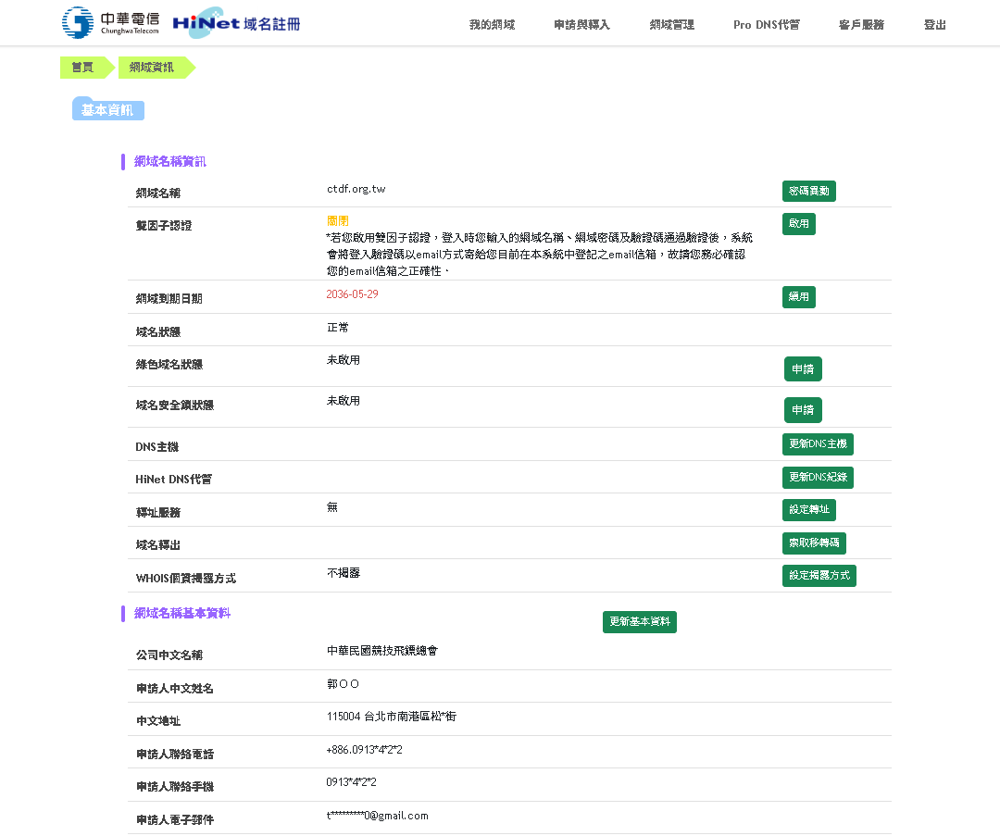

## 5. 在 Vercel 加入正式網域

### 5.1 進入 Domains

1. 登入 Vercel。
2. 開啟 `ctdf-web-production` 專案。
3. 進入 `Settings`。
4. 在左側選單按 `Domains`。

若尚未加入正式網域，Domains 畫面只會看到 Vercel 提供的專案網址。

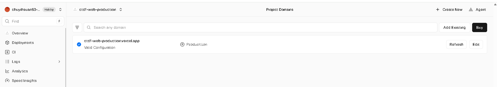

### 5.2 加入兩個網域

1. 按 `Add Existing`。
2. 加入 `ctdf.org.tw`。
3. 依畫面設定根網域轉向 `www.ctdf.org.tw`；本次畫面顯示 `308` 永久轉址。
4. 再確認 `www.ctdf.org.tw` 已列在 Production 網域中。

剛加入但 HiNet 尚未完成 DNS 設定時，兩筆網域顯示 `Invalid Configuration` 是正常現象。

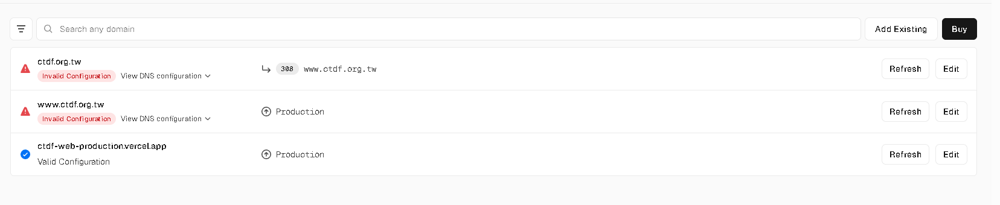

### 5.3 抄錄 Vercel 要求的 DNS 紀錄

在兩筆網域下方展開 `View DNS configuration`，逐筆確認 Vercel 指定的 Type、Name 和 Value。本次取得：

- `ctdf.org.tw`：`A`、名稱 `@`、值 `216.198.79.1`
- `www.ctdf.org.tw`：`CNAME`、名稱 `www`、值 `6f73b32267858949.vercel-dns-017.com.`

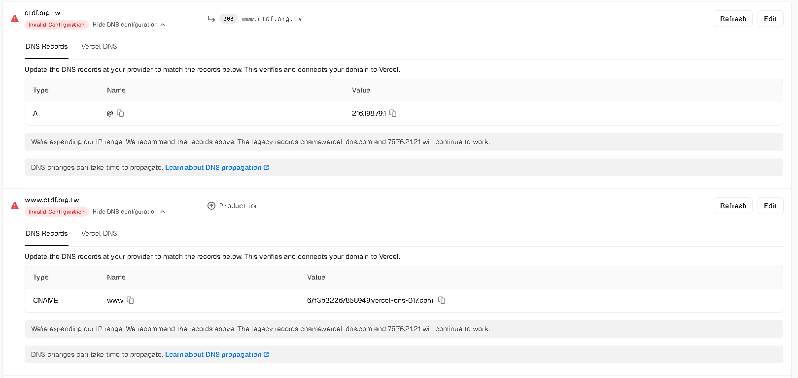

Vercel 畫面可能顯示 CNAME 結尾句點，但 HiNet 一般 DNS 代管欄位不接受該句點。填入 HiNet 時應刪除最後的 `.`。

## 6. 啟用 HiNet 一般 DNS 代管

### 6.1 同意使用 HiNet DNS 主機

1. 回到 HiNet 網域管理。
2. 按「更新 DNS 主機」或「更新 DNS 紀錄」。
3. 進入「DNS 代管－上層 NS 確認」畫面。
4. 選擇左側「同意」。
5. 按綠色「確定」。

系統預計設定：

- `admns1.hinet.net`
- `admns2.hinet.net`

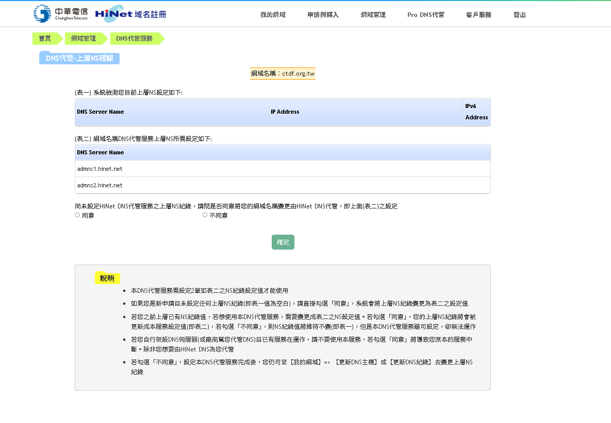

### 6.2 確認 DNS 代管已啟用

成功後，上層 NS 與 HiNet DNS 代管要求的 NS 會一致。按「前往代管設定頁面」。

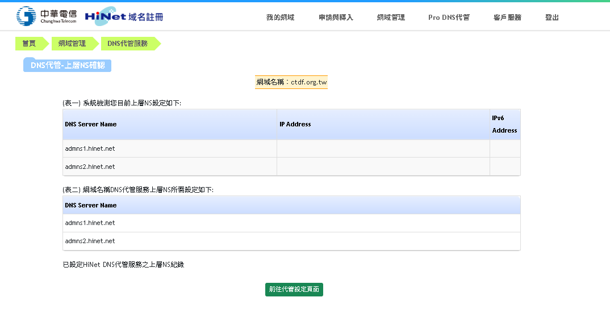

## 7. 在 HiNet 建立 DNS 紀錄

### 7.1 建立根網域 A 紀錄

在第 1 列填入：

- Ldata：保持空白，不要輸入 `@`
- TTL：保留 `86400`
- 記錄類型：選 `A`
- Rdata：`216.198.79.1`
- 其他欄位：保持空白

HiNet 會自動將空白 Ldata 接成根網域 `ctdf.org.tw`。

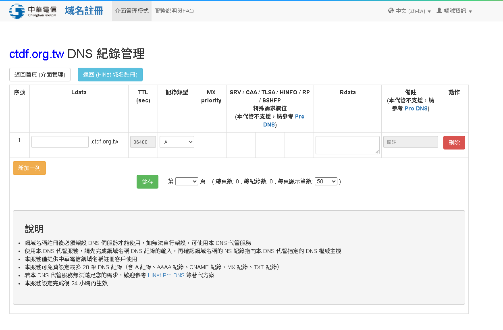

### 7.2 建立 www CNAME 紀錄

1. 按左下方橘色「新增一列」。
2. 在新列填入：
   - Ldata：`www`
   - TTL：保留 `86400`
   - 記錄類型：選 `CNAME`
   - Rdata：`6f73b32267858949.vercel-dns-017.com`
   - 其他欄位：保持空白
3. 不要輸入 `https://`、路徑或斜線。
4. 按綠色「儲存」。

## 8. HiNet CNAME 句點錯誤處理

第一次若直接貼上 Vercel 顯示的完整 CNAME，可能會包含結尾句點：

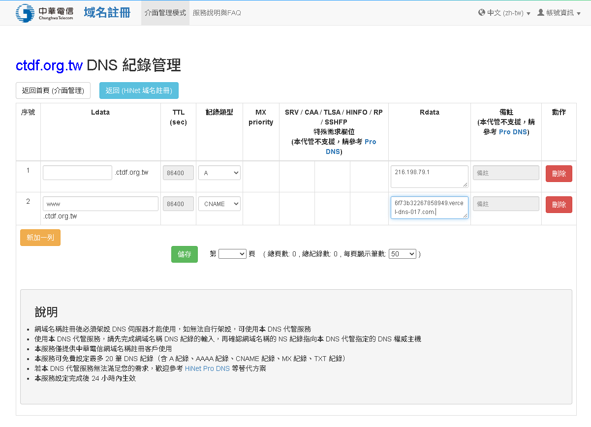

HiNet 會顯示：`CNAME Rdata 格式錯誤（注意結尾不用句點）`。

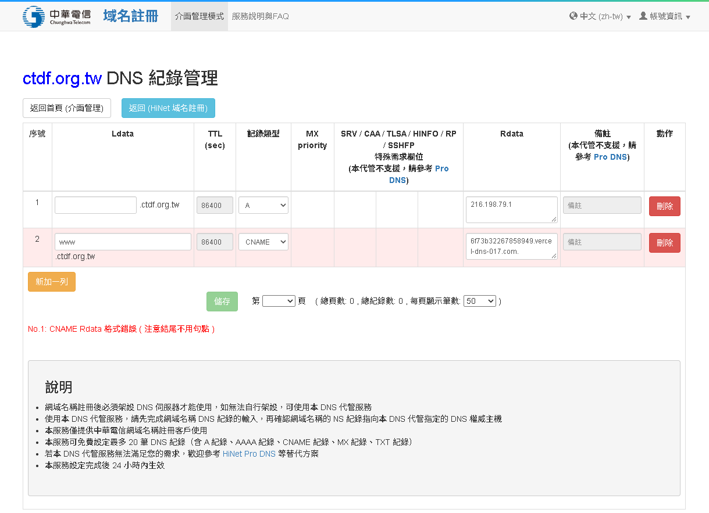

處理方式：

1. 將 CNAME Rdata 最後一個 `.` 刪除。
2. 確認值變成 `6f73b32267858949.vercel-dns-017.com`。
3. 其他欄位保持不變。
4. 再按一次「儲存」。

修正後的正確畫面如下：

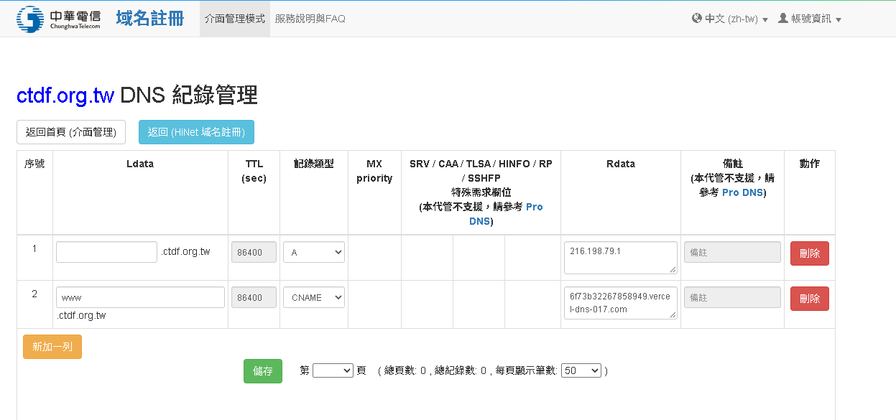

## 9. 確認並送出變更

HiNet 顯示異動確認頁後，再核對一次：

| 主機名稱 | TTL | 類型 | IP／主機名稱 |
|---|---:|---|---|
| `ctdf.org.tw` | `86400` | `A` | `216.198.79.1` |
| `www.ctdf.org.tw` | `86400` | `CNAME` | `6f73b32267858949.vercel-dns-017.com` |

確認無誤後按綠色「確認」，不要按「返回」。

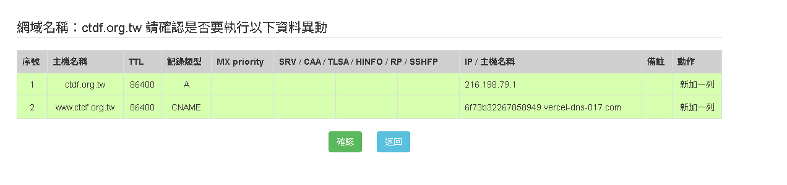

## 10. 回到 Vercel 驗證

1. HiNet 確認送出後，先等待約 5 至 15 分鐘。
2. 回到 Vercel 專案的 `Settings` → `Domains`。
3. 對 `ctdf.org.tw` 按 `Refresh`。
4. 對 `www.ctdf.org.tw` 按 `Refresh`。
5. 等待兩筆都顯示 `Valid Configuration`。
6. 分別開啟以下網址測試：
   - `https://ctdf.org.tw`
   - `https://www.ctdf.org.tw`
7. 確認根網域會轉向 `www`，首頁可正常顯示，瀏覽器沒有 HTTPS 憑證警告。

DNS 傳播通常數分鐘至數小時，HiNet 提示最長可能需要 24 小時。短時間仍顯示 `Invalid Configuration` 不代表設定失敗，先等待後再按 `Refresh`，不要反覆刪除及重建紀錄。

## 11. 常見問題

### 11.1 HiNet 顯示 CNAME 格式錯誤

原因：Rdata 結尾有句點。  
處理：刪除最後的 `.`，HiNet 中應填 `6f73b32267858949.vercel-dns-017.com`。

### 11.2 根網域欄位要填 `@` 嗎？

不用。HiNet 的 Ldata 保持空白，畫面右側會自動接上 `.ctdf.org.tw`。

### 11.3 要購買 Pro DNS 嗎？

本次只使用一般 HiNet DNS 代管即可建立 A 與 CNAME，不需要購買 Pro DNS。

### 11.4 這會把網域移轉到 Vercel 嗎？

不會。註冊商及網域管理仍是 HiNet，Vercel 只接收 DNS 指向後的網站流量。

### 11.5 超過 24 小時仍未通過

依序檢查：

1. HiNet 上層 DNS 主機是否為 `admns1.hinet.net`、`admns2.hinet.net`。
2. 根網域 Ldata 是否留空，類型是否為 A。
3. `www` 是否為 CNAME，且 Rdata 無結尾句點。
4. Vercel 是否仍要求相同的 A 與 CNAME 值。
5. 是否有另一筆同名 A、AAAA 或 CNAME 造成衝突。
6. 修正後等待 DNS 傳播，再按 Vercel `Refresh`。

## 12. 完成檢查表

- [ ] HiNet DNS 主機為 `admns1.hinet.net`、`admns2.hinet.net`
- [ ] 根網域 A 紀錄已建立
- [ ] `www` CNAME 已建立且沒有結尾句點
- [ ] HiNet 異動確認已按「確認」送出
- [ ] Vercel 兩筆網域皆顯示 `Valid Configuration`
- [ ] `https://ctdf.org.tw` 可正常開啟或轉址
- [ ] `https://www.ctdf.org.tw` 可正常開啟
- [ ] HTTPS 憑證正常
- [ ] 手機與桌機首頁皆已測試

## 13. 維護與安全提醒

- 不要在 GitHub、手冊或群組公開 HiNet、Vercel 的帳號密碼或驗證碼。
- 網域、DNS 與 Vercel 至少應有一位備援管理者。
- 修改 DNS 前先保存原紀錄截圖；不要在不明用途下刪除 MX 或 TXT 紀錄。
- 未來若網站搬離 Vercel，應先在新平台完成部署與測試，再修改 DNS，並保留回復方式。
- 每次 DNS 異動應記錄日期、操作人、原因、修改前後值與驗證結果。
